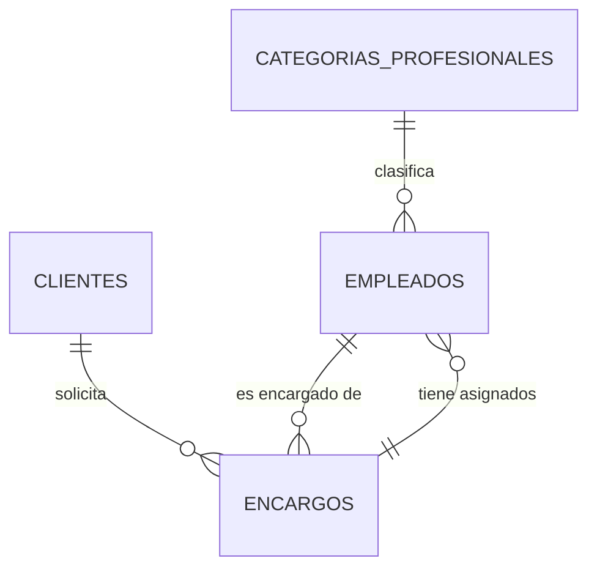

# RefriPolar API

API REST para gestionar **empleados, clientes y encargos** de *RefriPolar*, una empresa ficticia de refrigeración industrial. Es el backend común de dos clientes que desarrollé en el ciclo de **Desarrollo de Aplicaciones Multiplataforma (DAM)**: una app Android y una aplicación de escritorio.


### 🔗 Demo en vivo

**Swagger UI:** <https://refripolar-api.onrender.com/apirefripolar/>
· **Ejemplo:** [`/data/empleados`](https://refripolar-api.onrender.com/apirefripolar/data/empleados)

> La demo está alojada en el plan gratuito de Render (API) y Aiven (MySQL): si lleva un rato sin visitas, la primera petición puede tardar ~1 minuto en responder. Los datos son ficticios y pueden ser modificados por cualquiera desde Swagger.

## Stack

| Capa | Tecnología |
|------|------------|
| API REST | JAX-RS (Jersey 3) + JSON-B |
| Persistencia | JPA (EclipseLink 4) sobre MySQL 8 |
| Documentación | OpenAPI 3 + Swagger UI |
| Servidor | Apache Tomcat 10.1 |
| Build / despliegue | Maven, Docker Compose, GitHub Actions |

## Arrancarla en local

Solo necesitas **Docker**:

```bash
git clone https://github.com/AdrianColomoMoragues/refripolar-api.git
cd refripolar-api
cp .env.example .env        # opcional: cambia usuario/contraseña de la BD
docker compose up --build
```

- Swagger UI: <http://localhost:8080/apirefripolar/>
- Especificación OpenAPI: <http://localhost:8080/apirefripolar/doc/openapi.json>
- Ejemplo: <http://localhost:8080/apirefripolar/data/empleados>

La base de datos se crea y se rellena con datos de ejemplo (`db/init/01-bdrefripolar.sql`) la primera vez que arranca el contenedor de MySQL. Para empezar de cero: `docker compose down -v`.

### Sin Docker

Con Java 17, Maven, Tomcat 10.1 y un MySQL 8 propio:

```bash
mysql -u root -p -e "CREATE DATABASE bdrefripolarv1"
mysql -u root -p bdrefripolarv1 < db/init/01-bdrefripolar.sql
mvn package                                    # genera target/apirefripolar.war
export DB_URL="jdbc:mysql://localhost:3306/bdrefripolarv1?serverTimezone=UTC&useSSL=false&allowPublicKeyRetrieval=true"
export DB_USER=... DB_PASSWORD=...
# copia el .war a la carpeta webapps/ de Tomcat y arráncalo
```

## Endpoints

Base: `/apirefripolar/data`

| Recurso | Método | Ruta | Descripción |
|---------|--------|------|-------------|
| Empleados | `GET` | `/empleados` | Lista todos los empleados |
| | `GET` | `/empleados/{id}` | Un empleado |
| | `GET` | `/empleados/categoria/{codigo}` | Empleados de una categoría profesional |
| | `GET` | `/empleados/maxid` | Último id registrado |
| | `POST` | `/empleados` | Alta |
| | `PUT` | `/empleados` | Modificación |
| | `DELETE` | `/empleados/{id}` | Baja |
| Clientes | `GET` `POST` `PUT` `DELETE` | `/clientes`, `/clientes/{id}`, `/clientes/maxid` | CRUD de clientes |
| Encargos | `GET` `POST` `PUT` `DELETE` | `/encargos`, `/encargos/{id}`, `/encargos/maxid` | CRUD de obras y reparaciones; al crear un encargo se asignan sus empleados |
| Categorías | `GET` | `/categoriasprofesionales` | Categorías profesionales |

La documentación completa (esquemas y códigos de respuesta) está en Swagger UI.

## Modelo de datos



## Despliegue

La demo pública usa la misma imagen Docker que el entorno local:

| Pieza | Servicio | Configuración |
|-------|----------|---------------|
| API | Render (Web Service, Docker) | Variables `DB_URL`, `DB_USER`, `DB_PASSWORD` y `JAVA_OPTS=-Xmx300m` |
| Base de datos | Aiven for MySQL (plan gratuito) | Conexión con `sslMode=REQUIRED`; datos cargados desde `db/init/` |

## Estructura

```
src/main/java/com/refripolar/api/
├── config/   JpaUtil: EntityManagerFactory única, configurada por variables de entorno
├── model/    Entidades JPA
├── dao/      Controladores JPA (acceso a datos)
└── rest/     Recursos JAX-RS + configuración OpenAPI
src/main/webapp/   Swagger UI y web.xml
db/init/           Esquema y datos de ejemplo de MySQL
```

## Decisiones técnicas

- **Configuración por entorno**: URL, usuario y contraseña de la BD se leen de `DB_URL`, `DB_USER` y `DB_PASSWORD`; no hay credenciales en el código.
- **Una sola `EntityManagerFactory`** para toda la aplicación (crearla es costoso), que se cierra al parar Tomcat.
- **Consultas parametrizadas** en JPQL para evitar inyección a través de la URL.
- **El esquema lo gestiona el script SQL**, no JPA (`schema-generation = none`), para no tocar la BD al desplegar.

## Proyectos relacionados

- App Android de RefriPolar (cliente móvil)
- Aplicación de escritorio de RefriPolar (cliente de gestión)

---

Todos los datos de la base de ejemplo (personas, empresas, correos) son ficticios.
